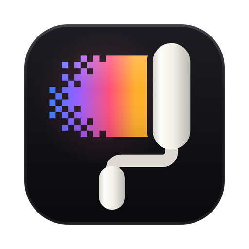

<p align="center"></p>
<h1 align="center">formvis</h1>
<p align="center"><b>Layered image compositing for the web and the desktop, in the NodeMode design system.</b></p>
<p align="center">


</p>

## What it is

formvis is a layered image editor: stack photos and paintings as layers, group them in folders, mask and clip them, blend them, select, paint and export. It saves its own `.fvd` projects and opens NodeMode canvasor projects, and it runs standalone in a browser, inside NodeMode as a portal app, or as a desktop app for macOS, Linux and Windows.

**Stack.** Vanilla TypeScript 7 and Vite 8 · Python 3.12 and FastAPI · Tauri 2 · about 159,000 lines of TypeScript, 2,300 of CSS, 21,900 of Python and 4,400 of Rust (product code, tests excluded; `./formvis counts` prints this, and `./formvis counts --check` verifies it).

## Highlights

- **Layered document model.** Flat bottom-to-top layers w/ pass-through folders, 27 blend modes in the standard order (17 drawn by Canvas 2D itself, 10 computed per pixel), raster masks, folder masks, clipping chains (Option-click a row's lower edge to clip or release), Option-drag mask copy, fill layers (Solid Color, Gradient and Pattern, endless and editable in Layer Content Options), and value-snapshot history (100 steps, 256 MB). The full set of layer commands: Bring to Front, Send to Back and Reverse, Merge Visible, Ungroup, Hide Layers, Delete Hidden Layers, Group from Layers, Layer from Background, All Layers, Link Layers and Select Linked Layers (linked layers move together), and Lock Layers for several at once; masks from the selection or the layer's transparency, Mask All Objects, Matting (Defringe, Remove Black and White Matte, Color Decontaminate) and Rasterize All Layers.
- **Home.** Start, Recent, Projects and Outputs pages beside a navigation column: recent files and exports as thumbnails or a list with filter and sort, a drop zone, and one-click new document sizes.
- **Its own project files.** Saves `.fvd`, each with a thumbnail inside (and still opens `.fmv` from before 1.87.0 and `.formvis` from before 0.90.0). In the desktop app Save writes back to the document's file and Save As and every export ask where in the system's save panel; Open and Browse use the system's open panel. A folder that is not a project opens its pictures and projects. It opens NodeMode canvasor projects (`.canvasor`, version 1), and opens `.comp` projects so they can be moved to formvis (it never writes `.comp`). Save a Copy, whole or flattened, leaves the document as it is; Revert goes back to the saved version as one undoable step; Close All and Close Others ask about each unsaved document, with Apply to All.
- **Forty-five tools.** Move w/ transform handles, Marquee (and Single Row and Column), Lasso (and Polygonal and Magnetic), Object Selection (click an object to select it; SAM 2.1 on ONNX Runtime in the engine, its model fetched on first use), Quick Selection, Magic Wand, Selection Brush, Crop, Brush, Pencil (hard pixel-exact lines, Auto Erase), Eraser, Background Eraser, Magic Eraser (the Brush's Brush Settings have tip shape, shape dynamics w/ pen pressure, tilt and rotation, scattering, texture, dual brush, color dynamics, transfer, noise and wet edges), Spot Healing (Content-Aware, Create Texture, Proximity Match), Remove, Healing Brush, Patch, Content-Aware Move, Red Eye, Clone Stamp, Pattern Stamp, History Brush (paints back a snapshot), Smear (Liquify, Blur, Sharpen, Smudge), Dodge, Burn, Sponge, Gradient, Paint Bucket, Shape, Path Selection, Direct Selection, Pen, Freeform Pen, Curvature Pen, Convert Point, Type (point and paragraph text, horizontal and vertical, and type masks), Frame (an imported image fills it), Eyedropper, Color Sampler, Ruler, Note, Count (with an Info panel), Hand, Rotate View and Zoom; each is a self-registering extension module. Content-Aware Fill works from the Edit menu, with Color Adaptation, Rotation Adaptation, Scale and Mirror (all off until chosen, because they cost time). The Artboard tool (V cycles it with Move) drags out artboards on empty canvas, with handles, a "+" to add one beside it and size presets; artboards read and write in PSD. The Slice and Slice Select tools cut a picture for Save for Web.
- **Adjustments and filters.** Twenty adjustment kinds: Levels w/ histogram, Auto and black, gray and white eyedroppers; Curves; Hue/Saturation w/ spectrum band handles, Sample, Add and Remove eyedroppers and targeted adjustment; Exposure, Brightness/Contrast, Vibrance, Color Balance, Black & White, Photo Filter, Channel Mixer, Selective Color, Shadows/Highlights, HDR Toning, Color Lookup (3D LUT .cube files or built-in looks), Gradient Map, Invert, Posterize, Threshold, Grain and Develop; as editable adjustment layers or direct edits; and Auto Tone, Auto Contrast, Auto Color, Desaturate, Equalize and Replace Color as direct edits. Seventy-two filters: the Filter Gallery, its 47 effects in six folders stacked as layers w/ their own preview, Liquify, Develop, Gaussian Blur, Lens Blur, Motion Blur, Radial Blur (Spin and Zoom), Surface Blur, the Blur Gallery's Field, Iris, Tilt-Shift, Path and Spin Blur, Add Noise, Lens Correction, Smart Sharpen, Shake Reduction and Unsharp Mask; Average, Blur, Blur More, Box Blur, Shape Blur and Smart Blur; Sharpen, Sharpen More and Sharpen Edges; Despeckle, Dust & Scratches, Median and Reduce Noise; Custom, HSB/HSL, High Pass, Maximum, Minimum and Offset; De-Interlace and NTSC Colors; Displace, Pinch, Polar Coordinates, Ripple, Shear, Spherize, Twirl, Wave and ZigZag; Color Halftone, Crystallize, Facet, Fragment, Mezzotint, Mosaic and Pointillize; Diffuse, Emboss, Extrude, Find Edges, Oil Paint, Solarize, Tiles, Trace Contour and Wind; Flame, Picture Frame, Tree, Clouds, Difference Clouds, Fibers, Lens Flare and Lighting Effects, w/ live preview; Last Filter repeats the last, and Edit > Fade fades a filter, adjustment, fill or stroke just made.
- **Brushes.** Window > Brush Settings sets a brush's tip shape (angle, roundness, spacing, size), shape dynamics from pen pressure, tilt and rotation, scattering, texture, dual brush, colour dynamics, transfer, noise and wet edges; sampled tips and presets come from `.abr` files (imported in the Brushes panel); the Brush, Pencil, Eraser, Mixer Brush and the retouching brushes share the engine, and a pen's pressure, a touch screen's force or a Force Touch trackpad's press drives size and flow. A stroke on a very large picture uses memory only around where it paints.
- **The native renderer.** `native/formvis-render` is a Rust command line over wgpu: `formvis-render info` names the graphics adapter and `composite --spec stack.json --out out.png` blends a stack of layers with every blend mode on the GPU (or a software adapter) and `bench` times it; the desktop app reaches it through `src-tauri`, and `GET /api/native/status` reports it.
- **Healing.** Spot Healing, the Healing Brush (Alt-click a source) and the Patch tool blend copied texture into its surroundings; Shift+J cycles them. The Clone Source panel (Window > Clone Source) keeps five sources for the Clone Stamp and Healing Brush, each with its own position, scale, angle and flips, and sets the overlay's Show, Opacity, Clipped and Auto Hide.
- **Paths.** The Pen draws Bezier paths and Direct Selection reshapes them; a path becomes a selection (Ctrl or Cmd with Enter) or is filled or stroked into a layer. Paths save with the project, and the Pen adds or deletes points on them. A Paths panel keeps named paths, and a path can become a shape layer whose outline stays editable. Shape layers take a fill, a stroke or both, combine with the usual operations (Unite, Subtract Front Shape, Intersect, Exclude, Merge Shape Components), and travel to and from PSD files as shapes.
- **Actions and Batch.** Record commands, filters, adjustments, layer styles and size changes into actions, replay them, share them as JSON, and batch-process a set of images into one zip. Size steps can follow each image, and Fit Image fits each one within a box. Stops and dialog pauses let an action wait for input.
- **Edit by asking, from Claude Code, Codex or Cursor.** formvis's MCP server gives agents 134 tools (files, layers, text, selections, filters, local-first generative fill, the video timeline, and the command catalogue), with Window > Agent Connect for the master switch, per-agent policy, approvals and the activity feed and the `formvis-driving` skill (with `formvis-colour-science` for profile questions) teaches them to use them; `./formvis agents install` sets all three up with every skill, formvis starts itself and asks you once to allow them. See [docs/AGENT_EVALS.md](docs/AGENT_EVALS.md) to check each client.
- **A terminal and Claude Code in the window.** Window > Terminal (Ctrl or Cmd+J when no layer is open or the dock has focus; with a layer open the key is Layer via Copy) opens a dock at the foot of the window with a real shell per tab, run by the engine (xterm.js in the window, a pseudo-terminal in the engine, ConPTY on Windows); Window > Claude Code (and the robot button in the title bar) shows the dock on a Claude Code tab with formvis's tools attached, and the ask bar at the dock's foot types a request into it; Window > Chat with Claude is the dock's Chat tab, which runs Claude Code on the open document with Ask, Auto-accept edits and Plan modes, Allow and Deny for its requests, Continue in Claude Code to resume the conversation in a tab, and its shell calls mirrored into a read-only terminal tab. Both answer only to formvis's own window on this computer.
- **One command catalogue, and `./formvis cli`.** Every menu command, tool, tool option and a few exact actions (a paint stroke through given points, a rectangle, ellipse or lasso selection, layer properties, an adjustment or a filter with exact values) is one command with an id and a description, 755 in this build. The command palette, the MCP tools `list_commands`, `describe_command`, `run_command` and `run_commands`, and `./formvis cli list|describe|run` all read it; a list of commands is one undo step.
- **The assistant.** Window > Assistant is a chat beside the canvas that edits the open document through the same tools, on the language model set in Preferences > Plugins; each command it runs is its own row with a status and an Undo for that step, Plan first shows a numbered plan to run or cancel, the model is told to use formvis's own commands, and Undo This Turn takes back everything since your last message.
- **Help in the app.** Help > formvis Help (F1) is the manual ([docs/MANUAL.md](docs/MANUAL.md)) with its contents, a search, and questions answered from it by the language model set in Preferences > Plugins. Edit > Search (Ctrl+K) finds any command or tool from a few letters of its name and runs it.
- **Thirty interface languages.** English is the default; Spanish, Mexican Spanish, Brazilian Portuguese, French, Canadian French, German, Italian, Dutch, Danish, Finnish, Norwegian Bokmål, Swedish, Russian, Polish, Czech, Hungarian, Ukrainian, Turkish, Greek, Serbian (Latin script), Simplified and Traditional Chinese, Japanese, Korean, Indonesian, Thai, Vietnamese, Arabic and Hindi (the last two drafts for review) are chosen in Preferences, or from the system's language at the first start, and switch in place. Menus, panels, dialogs, tool names, options bar labels, filter and adjustment names and the status bar are translated; your own layer, document and preset names never are. [Languages](.docs/wiki/Languages.md) says how the tables work.
- **A tool bar and panels you arrange.** Edit > Toolbar drags tools between groups and into Extra Tools (Restore Defaults, Clear Tools; saved in the preferences). Window lists the Clone Source, Adjustments, Notes, Histogram, Gradients, Patterns, Shapes, Styles, Character Styles, Layer Comps, Measurement Log and Modifier Keys panels; the Gradient Editor has separate opacity stops and colour midpoints, kept in `.grd` files, and the History panel marks the step Fill with History paints from.
- **Window > Arrange.** Tile All Vertically and Horizontally, 2-up to 6-up, Consolidate All to Tabs, and Match Zoom, Location, Rotation and All; New Window for Document, Float in Window and Float All in Windows give a second view of a document or put views in floating frames, and the gutters between tiles drag. Extra views and floating frames pan, zoom and rotate but take no tool input.
- **Export and Save for Web.** Export As takes a canvas size, a metadata choice (Document File Info, None, or Copyright and Contact Info) and several sizes at once with file name suffixes. Save for Web (Legacy) shows 2-Up and 4-Up views of three variants with file sizes and download times, writes true 8-bit PNG (colours, dither, transparency), has a metadata choice, and File > Export > Generate Image Assets regenerates assets on save. Layers, Artboards and Layer Comps to Files, Artboards to PDF, Print, Package and Color Lookup Table export sit beside them.
- **Plugins and the Script Console.** JavaScript plugins (Plugins > Manage Plugins) add commands to the Plugins menu; each runs in a sandbox, changing the document only through formvis's tools, undoable, and never seeing your keys or files. Window > Script Console runs JavaScript with `formvis.run`, `formvis.commands`, `formvis.api` (the plugin API) and `formvis.log` in scope, with no wider reach than a plugin has.
- **Local generation.** Krea 2 Turbo and FLUX.2 [klein] 4B on this computer (Preferences > Plugins > Local models), with no key and no cost: in Generate Image, and Krea 2 in Generative Fill and Expand; LoRAs and checkpoints; Image > Upscale with Real-ESRGAN; and Generative Fill and Expand with LaMa on any computer, no prompt needed. [docs/LOCAL.md](docs/LOCAL.md) lists what runs locally and what each needs.
- **Smart objects.** Keep a layer's original pixels, with filters on it that stay editable, can be hidden or removed, and re-render from the original. Edit Contents opens the original as its own document; saving it updates the object. Distort and Perspective stay editable on them. They travel to and from PSD files as smart objects.
- **Animation.** A Timeline of frames, each keeping layer visibility, opacity and position with a delay, tweened, reordered by dragging, played in a preview and exported as an animated GIF.
- **History.** A History panel lists every step kept; clicking one goes back or forward to it. Snapshots keep states to return to at any time.
- **PSD and PSB files.** Open layered `.psd` and `.psb` files and export to them, keeping layers, folders, masks, clipping, opacity, blend modes, visibility and live adjustment and fill layers.
- **Layer styles.** Drop Shadow, Outer Glow, Stroke, Inner Shadow, Inner Glow, Satin, Bevel and Emboss (Smooth or chiselled, Stroke Emboss, with Contour and Texture), and Color, Gradient and Pattern Overlay for any pixel layer, drawn from its visible pixels and previewed live; copy, paste and clear them across layers, scale them, hide them all, set the Global Light, or turn a style into layers of its own. They save in `.fvd` projects.
- **Graphics processor.** The canvas draws through WebGPU (Metal on macOS, Direct3D 12 on Windows) or WebGL2 (as on Linux), with every blend mode but Dissolve, masks, folders, clipping, adjustment layers and layer styles, falling back to the CPU per document with the reason in the status bar; the engine's models run on CUDA, Core ML (Metal) or the CPU (Preferences > Performance); Help > Performance Benchmark times both paths.
- **Type.** The Type tool adds editable text layers, typed straight onto the canvas, in any font on this machine (in Chromium, the full system list with your permission), with size, line height, tracking, kerning, alignment, bold, italic and colour, and Warp Text's fifteen styles, kept editable, and type set along a pen path, and paragraph styles kept in the document; painting on type turns it into pixels.
- **Generative Fill, Expand and Upscale (optional).** Edit > Generative Fill paints a selection from a prompt, or removes what it covers with an empty prompt, through FLUX.1 Fill and Erase on fal; Image > Generative Expand grows the canvas and fills the new border; Image > Upscale enlarges 2 or 4 times with Real-ESRGAN. Set `FAL_KEY` or paste a key into the dialog once; the engine keeps it. Filter > Develop adds Camera Raw-style tone, colour and detail controls.
- **Precise transforms.** Move snaps to the canvas and other layers w/ guides and takes exact X, Y, W, H, Scale and Angle values; several selected layers, or a folder, transform together; drag inside a selection to move or duplicate its pixels; Transform Selection (Alt+Mod+T) floats them w/ handles and merges back, growing the layer past its edges; Edit > Transform's Again (Shift+Mod+T, on a copy w/ Alt), Scale, Rotate, Skew, Distort, Perspective, Warp and the layer's quarter turns and flips.
- **Clipboard, selections, canvas.** Cut, Copy, Copy Merged, Paste in place, Paste Into and Paste Outside through a mask, Layer via Copy and Layer via Cut; Edit > Stroke along the selection's edge; Toggle Last State; Expand, Contract and Mask's Black Areas; Reselect, Grow, Similar, Transform Selection of the outline alone, and Convert to Shape; Save and Load Selection w/ alpha channels kept in the project and shown in Channels; Find and Isolate Layers; arrow-key nudging, marquee autoscroll, Anti-alias, and the Magic Wand's Sample Size; Canvas Size w/ anchors, Image Size w/ resampling, Image Rotation by any angle, Image > Crop to the selection, and Duplicate, whole or merged.
- **Two background removers, one refine panel.** U²-Net (ML, the default: run on ONNX Runtime, its model fetched on first use; through rembg when that is installed) and OpenCV GrabCut (lightweight, always available) feed Basic, or Advanced w/ Refine (guided filter, for hair and fur), Contrast and Shift Edge; the result is an editable layer mask, never destroyed pixels.
- **Color picker and JPEG export.** A full colour picker (saturation and brightness field, hue strip, RGB, hex) that can sample the canvas; a JPEG sheet w/ quality and a live encoded preview.
- **Zero-flash UI.** Keyed DOM patching, a two-canvas stage redrawn synchronously on resize, reveal gated on fonts; each interface change is verified w/ a 6x CPU and slow-network browser run: layout shift 0, no rebuilt rows, no errors.
- **NodeMode native.** NodeMode tokens and 14 theme profiles, the host theme bridge, the portal ready and init protocol, and a send-to-canvas message.
- **HEIC and TIFF import.** Decoded server-side w/ Pillow and pillow-heif, falling back to `sips` on macOS.
- **QOI, Netpbm, TGA and ICO.** Open and export from the specifications in the engine (no new dependency): QOI, PBM/PGM/PPM/PAM (16-bit files open as 16-bit documents), TGA (colour-mapped, RLE, any origin) and Windows icons (every size read, a chosen set written).
- **Camera RAW import.** DNG, CR2, CR3, NEF, ARW, RAF, ORF, RW2 and more, developed server-side by LibRaw (via rawpy) w/ the camera's white balance, then opened into Develop. Opening one camera RAW shows Camera Raw first: a preview, White Balance (As Shot, Auto, Daylight), Temperature and Tint applied in the RAW decode, and 8 or 16 bits per channel.
- **Depth, profiles and CMYK.** 8, 16 and 32 bits a channel (16-bit PNG and TIFF, Radiance HDR, OpenEXR and float TIFF in and out; a multi-part OpenEXR opens with one layer per part, named after it, in a 32-bit document); DPX in and out at 8, 10, 12 and 16 bits (Export As keeps bit depth and transfer); document profiles, Assign and Convert to Profile (RGB, CMYK, Gray or Lab, at 16 bits through LittleCMS in the engine, with optional dither), Edit > Color Settings for the working spaces, policies and intent, Proof Colors and Gamut Warning; Image > Mode > CMYK Color keeps true C, M, Y and K ink through a shipped FOGRA39 profile or one of your own, with CMYK TIFF and JPEG in and out. Nothing drops depth or ink quietly: what is not built at that depth or mode waits in the menu.

## Quick Start

Requirements: Node 20.19 or newer (22 recommended), Python 3.10 or newer (3.12 recommended), git. The desktop build also needs Rust stable and the Tauri 2 system packages for your OS.

### macOS and Linux

```bash
git clone https://github.com/nodemode-ai/formvis.git
cd formvis
./formvis install
./formvis boot
```

### Windows

```bat
git clone https://github.com/nodemode-ai/formvis.git
cd formvis
formvis.bat install
formvis.bat boot
```

`./formvis install` installs formvis with ONNX Runtime, so Object Selection (SAM 2.1), Select Subject and Remove Background (U²-Net), LaMa and Real-ESRGAN need nothing else: each fetches its model on first use, pinned to its checksum, or from Preferences > Plugins > Local models. The optional extras (rembg, and torch for SAM 2.1 on a GPU) come with `./formvis install-ml`; `./formvis install --lite` skips them. For the desktop app in one step, run `./build_app` (macOS and Linux): it installs whatever is missing, freezes the engine, compiles the Tauri shell and leaves `formvis.app` in Applications (macOS, with a `.dmg`) or a `.deb` (Linux), logging to `build_app.log`; Rust builds in a local cache (`~/Library/Caches/formvis/tauri-target` on macOS, `~/.cache/formvis/tauri-target` on Linux, `FORMVIS_CARGO_TARGET` to move it); `./build_app --help` lists its options. Step by step it is `./formvis install-desktop`, then `./formvis desktop dev` or `./formvis desktop build`. `./formvis help` lists every command.

| Service | URL | Notes |
| --- | --- | --- |
| Frontend (dev) | http://localhost:5190 | Vite, bound to localhost only, strict port |
| Engine | http://127.0.0.1:8190 | FastAPI; API under `/api`; serves the built app in `./formvis serve` |
| Preview | http://localhost:5191 | `vite preview` of the production build |
| Desktop engine | random loopback port | picked by the OS, read by the Tauri shell from the startup line |

## Configuration

The engine reads `backend/.env`, which is never committed; `backend/.env.example` is the template.

| Variable | Purpose |
| --- | --- |
| `FORMVIS_HOST` | Engine bind address |
| `FORMVIS_PORT` | Engine port; `0` picks a free port (desktop) |
| `FORMVIS_DATA_DIR` | Project library and exports root (default `~/Formvis`) |
| `FORMVIS_CORS_ORIGINS` | Allowed browser origins for the dev frontend |
| `FORMVIS_REMBG_MODEL` | rembg model name for ML background removal |
| `FORMVIS_DIST` | Built frontend folder the engine serves |
| `FORMVIS_FREEZE_ML` | `1` bundles rembg into the frozen desktop engine |
| `FORMVIS_TARGET` | Target triple override for the frozen sidecar |

## Architecture

```text
formvis/
├── formvis, formvis.bat           root dispatcher: install, boot, build, serve, desktop, doctor, test
├── formvis_oc_install(.bat)        one-command install
├── setup/                           one script per task, each w/ a .bat twin; lib.sh holds shared helpers
├── assets/                          repo art (README logo, desktop icon source), not app runtime files
├── backend/                         FastAPI engine
│   ├── app/core/config.py           ports, limits, data folders
│   ├── app/routers/                 system, io, projects, ops, generative
│   ├── app/services/                imaging, project_format, sessions, background, compute, generative
│   └── formvis_engine.py           PyInstaller entry for the desktop sidecar
├── frontend/                        Vite app, vanilla TypeScript
│   ├── src/engine/                  document engine, no DOM: layers, renderer, history, selections, strokes
│   ├── src/gpu/                     GPU detection, the WebGPU and WebGL2 displays, fallback rules, benchmark
│   ├── src/extensions/              tool registry and one module per tool
│   ├── src/ui/                      shell, stage, layers panel, menus, dialogs, icons, themes
│   ├── src/io/                      engine client, image decoding, project serialization
│   └── src/styles/                  NodeMode tokens and component sheets
├── src-tauri/                       Tauri 2 shell: sidecar spawn, port handshake, window sizing
├── .docs/                           BRANCHING.md and the wiki source
├── .github/workflows/               ci, wiki publish, desktop release matrix
└── .claude/skills/                  formvis-harness, formvis-driving, formvis-colour-science (mirrored to .agents/skills)
```

## Development

Branch model: `main` plus short-lived work branches, see `.docs/BRANCHING.md`. Docs live in `.docs/wiki/` and publish to the GitHub wiki on merge. Contributions follow the dev-rules laws: single-region hand edits, zero DOM flash or re-render, no emoji, no em dash, no icon-library dependencies, `v*.*.*` versions, Conventional Commits. Project skills live in `.claude/skills/`; start at `formvis-harness/SKILL.md` for code and `formvis-driving/SKILL.md` for editing pictures through the MCP tools. Read `frontend/HASHOUT_LOG.md` and `backend/HASHOUT_LOG.md` before editing.

## Status

Release history, with each version's test counts: `CHANGELOG.md`. What is not verified yet:

- **Desktop app.** The Tauri shell follows a proven sidecar template, with macOS signing and notarization, the hardened runtime, file associations and in-app updates from GitHub Releases wired (setup on the wiki's Releasing page). Since 1.43.0 the shell passes `cargo check` on Linux (WebKitGTK), and its font command's unit test runs there; that first check found, and 1.43.0 fixed, a missing dependency that had kept it from compiling anywhere. Not verified yet: a full build and running the app (they need the frozen engine and a display), and the macOS and Windows builds; the desktop workflow has not run. Treat desktop bundles as untested until the first `desktop.yml` run passes. Opening a clicked file in the running desktop app is not built yet.
- **The graphics processor on real hardware.** The web GPU paths are checked against the CPU in a test browser with a software GPU, where WebGPU cannot present to the screen; on-screen WebGPU, CUDA or Core ML running the engine's models, and Help > Performance Benchmark's numbers on real hardware are still to be run. The native renderer (1.44.0) is tested on Mesa's software Vulkan (21 tests, and a window screenshotted and measured under Xvfb); on real hardware: in native/formvis-render run `cargo run --release --example window` (a document drawn in a native window) and `cargo run --release --bin brush_bench` (milliseconds per brush update on a 4,000 px document, printed with the GPU's name); in the desktop app choose Preferences > Performance > Renderer > Native GPU and check that the interface shows over the canvas.
- **ML background removal.** Exercised end to end since 1.42.0: Select Subject's browser tests run on the ML engine (u2net) where the AI extras are installed, and pass; the lightweight GrabCut path is verified too. Click-to-select (SAM 2.1) is tested end to end on the CPU; its speed on CUDA or Apple's MPS is not measured yet.
- **NodeMode embedding.** Follows the portal protocol; the host-side handling of `plugin:formvis:assign` is not confirmed yet.

## Contributors

- **nodemode-ai** · owner and build

## Licensing

Apache License 2.0. Copyright 2026 nodemode-ai. See `LICENSE`.
