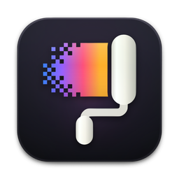
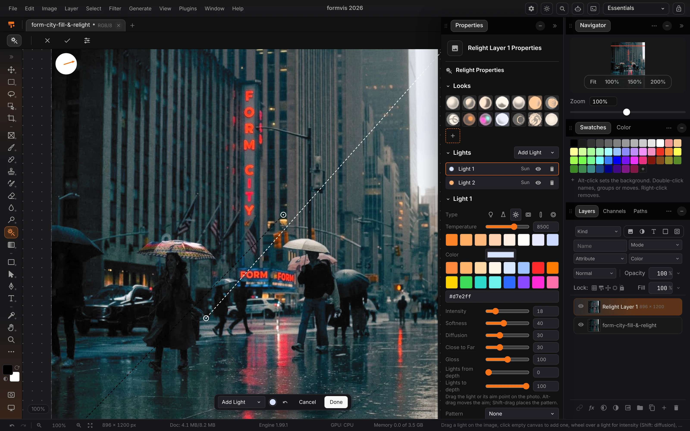
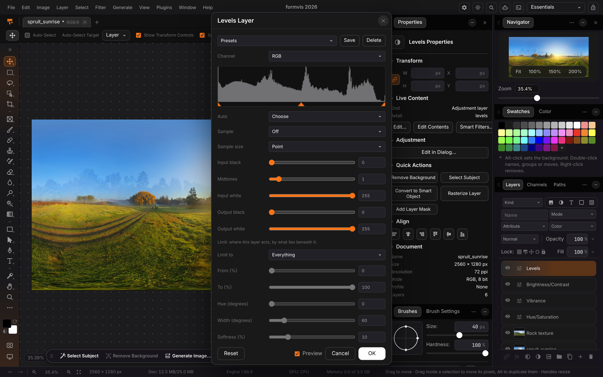
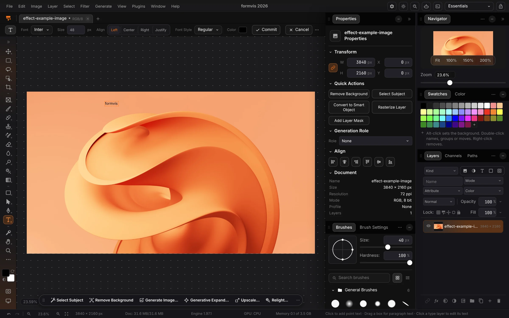

<p align="center">
  
</p>

<h1 align="center">FormVis</h1>

<p align="center">
  <b>Image editing; the layered photo editor of the Form family.</b><br>
  Layers, masks, blend modes, adjustment layers, layer styles and PSD files,<br>
  with local generation, on your own machine. No account, and agents can edit over MCP.
</p>

<p align="center">
  
  
  
  
  
  
</p>

<p align="center">
  <a href="https://formvis.formai.studio/"><b>Download FormVis on formai.studio</b></a> ·
  <a href="#run-it-from-source">Run it from source</a> ·
  <a href="#the-form-family">All Form apps</a>
</p>

<br>

<p align="center">
  
  <br>
  <sub>Relight at work: a cool key and a warm rim placed on the photo, with the neon left untouched; their controls are in the Properties panel and the Relight layer sits above the original.</sub>
</p>

<p align="center">
  <a href="#features">Features</a> ·
  <a href="#everything-in-the-box">In the box</a> ·
  <a href="#built-for-agents">Agents</a> ·
  <a href="#under-the-hood">Under the hood</a> ·
  <a href="#download">Download</a> ·
  <a href="#run-it-from-source">Run from source</a> ·
  <a href="#the-form-family">Form family</a>
</p>

<br>

<table>
  <tr>
    <td width="25%" valign="top"><h3>Layered</h3>Stack photos in folders, mask and clip them, and blend with 27 blend modes. History keeps 100 steps.</td>
    <td width="25%" valign="top"><h3>Non-destructive</h3>Adjustment layers, layer styles and smart objects stay editable, and layered PSD and PSB files open and save.</td>
    <td width="25%" valign="top"><h3>Local AI</h3>Krea 2 Turbo, FLUX.2 klein, LaMa and Real-ESRGAN run on this computer, with no key and no cost.</td>
    <td width="25%" valign="top"><h3>Agent-ready</h3>The same command catalogue drives the window, a command line and an MCP server for Claude Code, Codex and Cursor.</td>
  </tr>
</table>

<br>

## Features

<table>
  <tr>
    <td width="50%" valign="top">
      
      <br><sub>A Levels adjustment layer with a live histogram and preview.</sub>
      <h3>Adjustments that stay editable</h3>
      Levels, Curves, Hue/Saturation and more sit above your pixels as layers. Change or hide them any time.
    </td>
    <td width="50%" valign="top">
      
      <br><sub>The Type tool with its options bar, and the full panel layout.</sub>
      <h3>Tools, type and panels</h3>
      Select, paint, heal, retouch, draw paths and set type. Arrange the tool bar and panels your way.
    </td>
  </tr>
</table>

## Everything in the box

<table>
  <tr>
    <td width="33%" valign="top"><h4>Edit</h4>Layers · Masks · Clipping · Folders · Fill layers · Selections · Paths · Smart objects · Layer styles · Timeline and GIF</td>
    <td width="33%" valign="top"><h4>Adjust and generate</h4>Levels · Curves · Hue/Saturation · Exposure · Vibrance · Color Lookup · Filter Gallery · Healing · Generative Fill and Expand · Upscale · Background removal</td>
    <td width="33%" valign="top"><h4>Formats</h4>Opens: PSD · PSB · HEIC · TIFF · camera RAW · EXR · HDR · DPX · QOI · TGA · ICO · Saves: PNG · JPEG · PSD · TIFF · GIF · Native: <code>.fvd</code></td>
  </tr>
</table>

## Built for agents

The window, the command line and the MCP server call the same command catalogue, so what you can click an agent can run.

```sh
./formvis cli list                     # every command of the open window
./formvis cli describe adjust.apply    # what a command takes, with its parameters
./formvis mcp                          # MCP server on stdio for Claude Code, Codex and Cursor
```

`.mcp.json`, `.codex/config.toml` and `.cursor/mcp.json` are already wired in this repo. See [`AGENTS.md`](AGENTS.md).

## Under the hood

- **Engine:** a FastAPI service for decoding, colour, PSD and the local models on ONNX Runtime.
- **Editor:** vanilla TypeScript and Vite, with a DOM-free document engine; a Tauri 2 shell starts the engine as a sidecar.
- **Drawing:** WebGPU or WebGL2, falling back to the CPU per document.
- **Size:** about 166,800 lines of TypeScript, 2,400 of CSS, 22,500 of Python and 6,700 of Rust (product code, tests excluded; `./formvis counts --check` verifies it).
- **Tested:** unit, backend and browser suites, run with `./formvis test`.

## Download

**Get the app:** download FormVis from [formai.studio](https://formvis.formai.studio/). That is the easiest way to install it.

**Releases:** builds are published in [FormCompiler's releases](https://github.com/nodemode-dev/formcompiler/releases?q=formvis-v&expanded=true).

**Keep it updated:** [FormPortal](https://github.com/nodemode-dev/formportal) installs, updates and rolls back every Form app from the same signed catalogue.

| Platform | Builds |
|---|---|
| macOS Apple silicon · Linux x64 · Windows x64 | desktop app |

All FormVis builds are compiled and released from [`nodemode-dev/formcompiler`](https://github.com/nodemode-dev/formcompiler/releases), not from this repo. This repo holds the source.

## Run it from source

Prefer it in your browser, or want to contribute? Run the web UI straight from this repo.

**Requires:** Node 20.19 or newer, Python 3.10 or newer and git. The desktop shell also needs Rust and the Tauri 2 system packages.

```sh
git clone git@github.com:nodemode-dev/formvis.git
cd formvis
./formvis install   # installs the engine, the local-model runtime and the frontend
./formvis boot      # web UI at http://localhost:5190
```

`./formvis desktop dev` opens the desktop window instead.

On Windows use `formvis.bat install` and `formvis.bat boot`. The engine listens on http://127.0.0.1:8190; `FORMVIS_DATA_DIR` moves the project library (default `~/Formvis`).

> [!IMPORTANT]
> **Status:** alpha. The desktop bundles and the GPU paths on real hardware are not verified yet; see [`CHANGELOG.md`](CHANGELOG.md) and [`docs/ALPHA_REVIEW.md`](docs/ALPHA_REVIEW.md).

**Contributing:** branch from `main`, keep changes to source here, and leave packaging and releases to FormCompiler. See [`.docs/BRANCHING.md`](.docs/BRANCHING.md) and [`AGENTS.md`](AGENTS.md).

## Repository

| Path | What it is |
|---|---|
| `backend/` | FastAPI engine: routers, imaging, project format, local models |
| `frontend/` | Vite app: document engine, tools, GPU display, UI shell |
| `native/` · `src-tauri/` | The Rust wgpu renderer · the Tauri 2 desktop shell |
| `setup/` · `e2e/` · `docs/` | Scripts behind `./formvis` · browser tests · manual and README images |

Docs: [`.docs/wiki`](.docs/wiki) · Agents: [`CLAUDE.md`](CLAUDE.md), [`AGENTS.md`](AGENTS.md) · Contributing: [`.docs/BRANCHING.md`](.docs/BRANCHING.md)

## The Form family

FormVis is one of the **Form apps**: native creative tools that install, update and roll back through FormPortal and can all be driven by agents.

| | App | What it's for | Download | Code |
|:-:|---|---|---|---|
|  | **form.md** | Documents, databases and realtime editing together | [formai.studio](https://formmd.formai.studio/) | [GitHub](https://github.com/nodemode-dev/form.md) |
|  | **FormAT** | Chat and agent workspace on your key | [formai.studio](https://format.formai.studio/) | [GitHub](https://github.com/nodemode-dev/format) |
|  | **FormCAD** | Drafting, parametric parts and NURBS surfaces | | [GitHub](https://github.com/nodemode-dev/formCAD) |
|  | **FormCel** | Spreadsheets agents can read and edit | [formai.studio](https://formcel.formai.studio/) | [GitHub](https://github.com/nodemode-dev/formcel) |
|  | **FormCraft** | Generate images, video, audio, 3D and worlds | | [GitHub](https://github.com/nodemode-dev/formcraft) |
|  | **FormCut** | Multi-track video editing with no upload | [formai.studio](https://formcut.formai.studio/) | [GitHub](https://github.com/nodemode-dev/formcut) |
|  | **FormDAM** | Photo library and asset manager | [formai.studio](https://formdam.formai.studio/) | [GitHub](https://github.com/nodemode-dev/formDAM) |
|  | **FormDeck** | Presentations and pitch decks | [formai.studio](https://formdeck.formai.studio/) | [GitHub](https://github.com/nodemode-dev/formdeck) |
|  | **FormDesign** | Page layout for print and the web | [formai.studio](https://formdesign.formai.studio/) | [GitHub](https://github.com/nodemode-dev/formdesign) |
|  | **FormEncoder** | Media encoding queue with presets | [formai.studio](https://formencoder.formai.studio/) | [GitHub](https://github.com/nodemode-dev/formencoder) |
|  | **FormFabric** | Sewing patterns draped with cloth simulation | | [GitHub](https://github.com/nodemode-dev/formfabric) |
|  | **FormLit** | Photo library and raw development | [formai.studio](https://formlit.formai.studio/) | [GitHub](https://github.com/nodemode-dev/formlit) |
|  | **FormMorpheus** | Frame-by-frame and performed animation | | [GitHub](https://github.com/nodemode-dev/formmorpheus) |
|  | **FormNET** | See what your computer sends online | | [GitHub](https://github.com/nodemode-dev/formNET) |
|  | **FormPath** | Vector illustration with artboards and type | [formai.studio](https://formpath.formai.studio/) | [GitHub](https://github.com/nodemode-dev/formpath) |
|  | **FormPDF** | Edit, redact, sign and fill PDFs | [formai.studio](https://formpdf.formai.studio/) | [GitHub](https://github.com/nodemode-dev/formpdf) |
|  | **FormPromo** | Promo films from your own media | [formai.studio](https://formpromo.formai.studio/) | [GitHub](https://github.com/nodemode-dev/formpromo) |
|  | **FormRef** | Reference boards for creative work | [formai.studio](https://formref.formai.studio/) | [GitHub](https://github.com/nodemode-dev/formref) |
|  | **FormRig** | Rig, skin and retarget any mesh | | [GitHub](https://github.com/nodemode-dev/formrig) |
|  | **FormSculpt** | 3D sculpting, remeshing and painting | [formai.studio](https://formsculpt.formai.studio/) | [GitHub](https://github.com/nodemode-dev/formsculpt) |
|  | **FormSurface** | Texture painting with PBR export | [formai.studio](https://formsurface.formai.studio/) | [GitHub](https://github.com/nodemode-dev/formsurface) |
|  | **FormTools** | Viewers, batch tools and file utilities | | [GitHub](https://github.com/nodemode-dev/formtools) |
|  | **FormTxt** | Word processing with .docx round trips | [formai.studio](https://formtxt.formai.studio/) | [GitHub](https://github.com/nodemode-dev/formtxt) |
|  | **FormVFX** | Motion graphics and VFX compositing | [formai.studio](https://formvfx.formai.studio/) | [GitHub](https://github.com/nodemode-dev/formvfx) |
|  | **FormVis** | Layered image editing with local AI | [formai.studio](https://formvis.formai.studio/) | [GitHub](https://github.com/nodemode-dev/formvis) |
|  | **FormWav** | Multitrack audio editing and mixing | [formai.studio](https://formwav.formai.studio/) | [GitHub](https://github.com/nodemode-dev/formwav) |
|  | **FormWeb** | Visual website building with a CMS | [formai.studio](https://formweb.formai.studio/) | [GitHub](https://github.com/nodemode-dev/formweb) |
|  | **FormPortal** | Install, update and roll back Form apps | [formai.studio](https://formportal.formai.studio/) | [GitHub](https://github.com/nodemode-dev/formportal) |
|  | **FormTray** | One dock icon for every app | [formai.studio](https://formtray.formai.studio/) | [GitHub](https://github.com/nodemode-dev/formtray) |
|  | **FormMCP** | One MCP connection to the family | [formai.studio](https://formmcp.formai.studio/) | [GitHub](https://github.com/nodemode-dev/formMCP) |
|  | **FormSkills** | Every app's agent skills in one place | [formai.studio](https://formskill.formai.studio/) | [GitHub](https://github.com/nodemode-dev/formskills) |
|  | **FormBench** | Parity, testing and rankings for the family | [formai.studio](https://formranker.formai.studio/) | [GitHub](https://github.com/nodemode-dev/formbench) |
|  | **FormSlot** | Codebase memory for coding agents | | [GitHub](https://github.com/nodemode-dev/formslot) |
|  | **SubForm** | Workbench for parallel Claude Code agents | | [GitHub](https://github.com/nodemode-dev/subform) |
|  | **FormCompiler** | Builds, signs and releases every app | [formai.studio](https://formcompiler.formai.studio/) | [GitHub](https://github.com/nodemode-dev/formcompiler) |
|  | **FormPipe** | Release pipeline and update feeds | | [GitHub](https://github.com/nodemode-dev/formpipe) |

<br>

---

## Maintainers

| Maintainer | Role |
|---|---|
| [@nodemode-ai](https://github.com/nodemode-ai) | Owner |
| [@gbarnai](https://github.com/gbarnai) | Co-owner |

Code owners are set in [`.github/CODEOWNERS`](.github/CODEOWNERS).

## License

FormVis is licensed under the Apache License 2.0 ([`LICENSE`](LICENSE), SPDX `Apache-2.0`). Copyright 2026 NodeAgentc, Inc. Third-party notices: [`NOTICE.md`](NOTICE.md).

This product includes DNG technology under license by Adobe Systems Incorporated.

<sub>Adobe, Camera Raw and Photoshop are either registered trademarks or trademarks of Adobe in the United States and/or other countries. FormVis is not affiliated with or endorsed by Adobe; the names describe file formats and compatibility only.</sub>

<sub>Screenshot content: CC0 photos from Poly Haven.</sub>
